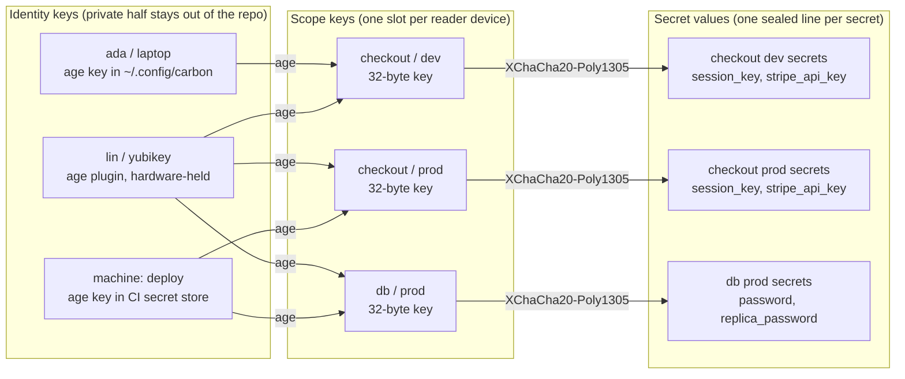
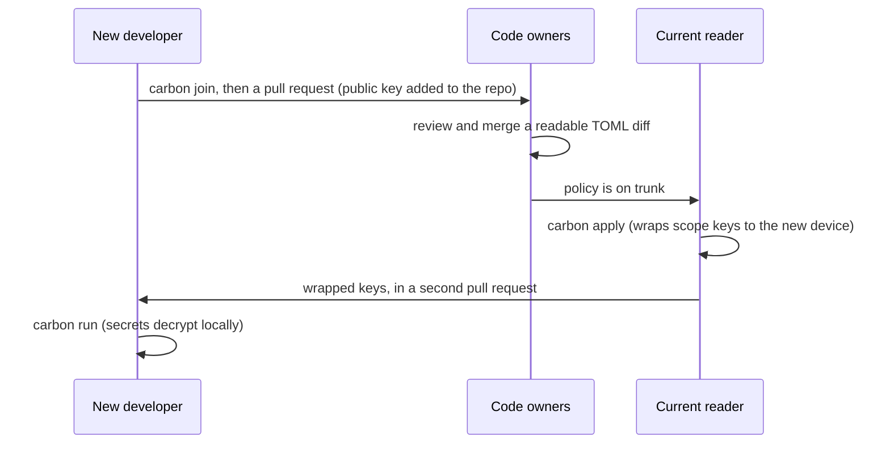

# Carbon 1.0: in-repo secrets for monorepos

This is the design for Carbon 1.0. It is maintained here, in the repository:
change it in the same pull request as the behaviour it describes. The exact
formats and rules are in [implementation.md](implementation.md), and the
decisions and limits found while building it are in
[deviations.md](deviations.md).

## Summary

Carbon 1.0 is a rewrite of carbon that keeps a monorepo's secrets encrypted inside the repo, grants access per package per environment, and needs no server. It keeps the name, the `carbon` binary, and the core idea of 0.0.3, and replaces the parts that kept it a proof of concept.

The design rests on seven decisions:

- **One static binary, written in Go.** No sops, nushell, or Nix at runtime. `carbon run` decrypts in-process.
- **Boring cryptography.** age wraps keys and XChaCha20-Poly1305 seals values. Nothing is novel, and every secret is recoverable with stock tools and a short script.
- **A scope is one package in one environment.** Each scope has its own key, so reading `payments` in `prod` implies nothing about `search` in `dev`.
- **Policy is plain TOML, enforced by encryption.** Reviewers read a one-line diff. CI checks the wrapped keys against it without holding a key.
- **Built for branches.** One line per secret, one line per reader device, and no file-wide MAC, so independent changes merge.
- **Anyone can add a secret; only readers can read one.** A contributor without access drops a value into the scope's inbox, so credentials never travel over chat.
- **Honest offboarding.** Removing someone rotates keys and lists every credential they could read, because revocation cannot un-share a secret.

Every question raised in review is settled. The answers are listed under Decisions made.

## Background: what carbon 0.0.3 proved, and where it stops

Carbon 0.0.3 proved the model: services declare what they publish and consume in a file beside their code, and an age-encrypted registry in the repo replaces a central config service. Its README says not to use it in production. The table lists what reading the source showed (935 lines of nushell over sops and rage) and how 1.0 responds.

| Area | Carbon 0.0.3 | Carbon 1.0 |
| --- | --- | --- |
| Access granularity | Per registry: anyone with `dev` reads every service's secrets | Per package per environment |
| Storage | One sops file per registry, shared by all services | One file per package per environment, beside the code |
| Merging | Every push rewrites the file's sops MAC, so two branches that push always conflict | Each value sealed on its own line, no file-wide MAC |
| Speed | One `sops` process per secret on every pull and push | One process, in memory |
| Private key | `.carbon/private-key.age` inside the repo, unencrypted, guarded only by `.gitignore` | Outside the repo, optionally passphrase or hardware protected |
| Identity | `request` records `$USER`; `rekey` wraps to whatever the working tree lists | Named people with device keys; grants come only from policy merged to trunk |
| Offboarding | Rotates the data key, keeps no record of what was exposed | Rotates keys and tracks rotation debt per secret |
| Plaintext | `pull` writes `.environment.json`; debug logs print secret values | `run` injects environment variables only; values are never logged |
| Setting a secret | Pull-then-push through a self-referencing `default` command, by someone with access | `carbon set`, by anyone |
| Config execution | `command` fields run through `sh -c` | Config is data; nothing in it is executed |
| Machines | No CI or deploy identity | Machine identities, and a check that needs no key |
| Runtime | nushell, sops, rage, git, and a Nix wrapper to pin them | One binary plus git |

Five ideas carry over unchanged: secrets live in the repo, each service declares its contract beside its code, `check` validates the dependency graph, `run` injects secrets into a child process, and access is requested by one person and granted by another who already has it.

## Goals and non-goals

Each goal is written so a test or a drill can pass or fail it.

1. A new developer goes from clone to a running service with three commands and one pull request.
2. Everything works offline with git and one binary. There is no server, account, or network call.
3. Access is scoped per package per environment, written as reviewable text, and enforced by encryption.
4. Independent secret and access changes on separate branches merge without conflict.
5. CI verifies the repo's whole secret state without holding a key.
6. Removing a person produces the exact list of credentials to rotate.
7. Every secret is recoverable without the `carbon` binary, using the stock `age` CLI and a published format.
8. `carbon run` adds under 50 ms for a package with 100 secrets.
9. A contributor can add a secret to a scope they cannot read, without sending it to anyone.

Non-goals:

- **Dynamic or leased credentials.** Carbon stores static secrets.
- **Hiding metadata.** Package names, secret names, and reader lists are plaintext so that diffs and reviews work.
- **Defending against a current reader.** Someone who can read a secret can copy it.
- **A runtime secret service.** There is no agent, sidecar, or API. Machine identities cover CI and deploys.
- **Scanning source code for leaked secrets.** Existing scanners do that.
- **Scopes finer than a package in an environment.** Where one secret needs tighter access, split the package.

## Developer experience

Daily use is four commands: `join` once, then `run`, `set`, and `status`. Every command works from any directory by finding the nearest package, the way git finds the nearest repo.

### Joining a repo

```console
$ carbon join
Created your identity   ~/.config/carbon/identity   (device: laptop)
Added your public key   .carbon/people/ada.toml
Fingerprint             tulip-anchor-seven-orbit

Next: open a pull request with this change and ask to be added to a team.
Access starts once it merges and a current reader runs `carbon apply`.
```

The private key never enters the repo. One identity serves every repo and worktree on the device.

### Running a service

```console
$ cd services/checkout
$ carbon run -- npm start
```

`run` resolves the package's `[env]` table, decrypts in memory, and executes the command directly with those variables. There is no shell in between, names are case-sensitive, signals are forwarded, and the exit code is the child's. Nothing is written to disk.

Tools that need a file get one explicitly with `carbon export --format dotenv`. It writes mode 0600 and refuses any path git does not ignore.

### Setting a secret

```console
$ carbon set stripe_api_key --env prod
Value for checkout/prod stripe_api_key (hidden):
Sealed. Commit services/checkout/.carbon/prod.secrets.toml

$ carbon set session_key --generate
Generated 32 random bytes for checkout/dev session_key. Nobody has seen it.
```

Values come from a hidden prompt or stdin, never from an argument, so they stay out of shell history and process lists. This replaces the pull-then-push bootstrap of 0.0.3.

The same command works without read access. The value goes to the scope's inbox, which only readers can open.

```console
$ carbon set webhook_secret --env prod
You cannot read checkout/prod, so this will be a drop: write-only for you.
Value for checkout/prod webhook_secret (hidden):
Dropped. Readers can use it at once; `carbon check` will flag it for review.
```

### Knowing where you stand

```console
$ carbon status
You are ada (laptop). Environment: dev.

Readable       41 scopes in dev, staging
Waiting        checkout/prod   requested in #812, not merged
You can grant  1 pending: lin/yubikey -> 41 scopes     carbon apply
Rotate         payments/prod stripe_api_key   set before sam was removed
```

### Errors

Every error states what happened, why, and the next command.

```console
$ carbon run --env prod -- ./migrate
error: you cannot read checkout in prod

  checkout/prod is readable by @payments and machine:deploy-checkout.
  You are ada, a member of @engineering.

  To ask for access:   carbon request checkout --env prod
```

### Command surface

| Command | Purpose | Needs read access |
| --- | --- | --- |
| `carbon run -- <cmd>` | Run a command with the package's environment | Yes |
| `carbon set` | Seal a secret, or drop one into the inbox | No |
| `carbon get` / `edit` | Read or bulk-edit secrets | Yes |
| `carbon ls` | List secret names and their state | No |
| `carbon export` | Write resolved values to an ignored file | Yes |
| `carbon env use <name>` | Pick the environment for this worktree | No |
| `carbon status` | What you can read, grant, and should rotate | No |
| `carbon init` | Create a workspace or a package | No |
| `carbon join` | Create an identity and add its public key | No |
| `carbon request <package>` | Propose yourself as a reader in policy | No |
| `carbon apply` | Apply merged policy: wrap, rotate, promote drops | Yes |
| `carbon remove <person>` | Remove a person, device, or machine from policy | No |
| `carbon who <package>` / `carbon access <person>` | Explain who reads what, and through which rule | No |
| `carbon check` | Validate graph, policy, and keys; the CI gate | No |
| `carbon graph` | Emit the package dependency graph as DOT | No |
| `carbon doctor` | Diagnose the local setup | No |

Every command takes `--json` and uses stable exit codes. Commands that change access print their plan and wait for confirmation.

## Repository layout and file formats

People write three kinds of file; `carbon` writes two. All are TOML, sorted, and one logical item per line so diffs and merges stay small.

```text
carbon.toml                    workspace: environments, default access
.carbon/
  people/ada.toml              a person and their device public keys
  machines/deploy-checkout.toml
  teams.toml                   named groups of people
services/checkout/
  carbon.toml                  package: secrets, vars, env, access
  .carbon/
    prod.secrets.toml          written by carbon: sealed values and drops
    prod.keys.toml             written by carbon: the scope key, wrapped per device
```

Access policy lives with the package it governs, so a monorepo's existing CODEOWNERS rules decide who approves access to what. The file and directory names match 0.0.3 on purpose; the migration section covers the cutover.

### Workspace: `carbon.toml` at the root

```toml
[workspace]
format = 1
environments = ["dev", "staging", "prod"]
default_environment = "dev"

[access]                       # default readers for every package
dev     = ["@engineering"]
staging = ["@engineering"]
prod    = { readers = ["@sre"], require_pq = true }
```

The file does not say which branch is trunk. A branch could edit that line and so choose its own policy. Trunk is `CARBON_TRUNK` if set, then `git config carbon.trunk`, then the remote's default branch, none of which a commit can change.

### Package: `services/checkout/carbon.toml`

```toml
name = "checkout"

[access]                       # replaces the workspace default, per environment
prod = ["@payments", "machine:deploy-checkout"]

[secrets]
session_key    = { description = "HMAC key for session cookies", generate = "random:32" }
stripe_api_key = { description = "Stripe restricted key", rotate_after = "90d" }
webhook_secret = { description = "Stripe webhook signing secret" }

[vars.public_url]              # plain per-environment config, not encrypted
dev  = "http://localhost:3000"
prod = "https://checkout.example.com"

[env]                          # what `carbon run` gives the process
SESSION_KEY    = "${session_key}"
STRIPE_API_KEY = "${stripe_api_key}"
DATABASE_URL   = "postgres://checkout:${db.password}@${db.host}:5432/checkout"
AWS_PROFILE    = "${env:AWS_PROFILE}"
```

The `[env]` table replaces the separate `pull` and `derive` sections of 0.0.3. A reference such as `${db.password}` is the import, and `carbon check` builds the dependency graph from references. A secret marked `private = true` cannot be referenced from another package, which covers the `deny_pull` item in the 0.0.3 backlog.

### People and teams

```toml
# .carbon/people/ada.toml
name = "Ada Okafor"
[devices]
laptop  = "age1qz8f..."
yubikey = "age1yubikey1q..."
```

```toml
# .carbon/teams.toml
engineering = ["ada", "lin", "sam"]
payments    = ["lin"]
```

### Sealed values and drops: `.carbon/prod.secrets.toml`

```toml
session_key = { key = "k3f9q2", set = 2026-11-02T17:04:11Z, value = "carbon1:9wN3..." }
stripe_api_key = { key = "k1a8c0", set = 2026-09-14T09:30:02Z, value = "carbon1:Qm7r..." }
webhook_secret = { key = "k3f9q2", set = 2026-11-10T08:12:40Z, drop = "age1:YWdlLWVuY3J5..." }
```

A `value` was sealed by a reader. `stripe_api_key` was set before the last rotation and stays under the retired key `k1a8c0`, which carried it. A `drop` was written by someone who may not be one, and stays marked that way until a reader's `carbon apply` promotes it.

`carbon ls` shows these states without a key: `sealed`, `drop`, `stale` (under a retired key that did not carry it, so its author is unproven), `unset`, and `undeclared`. A carried value under a retired key shows as `sealed (retired key)` with the old key id. Because `ls` opens nothing, its states come from the files' structure alone, and a retired record that would fail authentication looks the same. `carbon check` against trunk and the commands that open the scope (`get`, `run`, `export`, `apply`) are authoritative.

### Wrapped keys: `.carbon/prod.keys.toml`

```toml
scope   = "checkout/prod"
current = "k3f9q2"

[keys.k3f9q2]
created      = 2026-11-02T17:04:11Z
inbox        = "age1pq1x7c4..."         # public: anyone can drop a value to it
inbox_sealed = "carbon1:Rb1v..."        # its private half, sealed under the scope key

[keys.k3f9q2.slots]                     # to: hash of the public key the slot was wrapped to
"lin/laptop"              = { to = "sha256:9f2c...", slot = "age1:YWdlLWVuY3J5cHRpb24..." }
"lin/yubikey"             = { to = "sha256:41ab...", slot = "age1:YWdlLWVuY3J5cHRpb24..." }
"machine:deploy-checkout" = { to = "sha256:c07e...", slot = "age1:YWdlLWVuY3J5cHRpb24..." }

[keys.k1a8c0]                  # retired, kept because older values are still sealed under it
created      = 2026-06-01T10:00:00Z
retired      = 2026-11-02T17:04:11Z
reason       = "removed sam"
successor    = "k3f9q2"
predecessor  = "k0b2z7"              # the key k1a8c0 replaced; absent for a scope's first key
sealed       = "carbon1:Zk2p..."     # the old key, sealed under k3f9q2
carried      = ["sha256:5d0e...", "sha256:b71c..."]   # the values under this key when it was retired
inbox_sealed = "carbon1:Qm9t..."     # kept so drops made on older branches still open

[keys.k0b2z7]                  # the scope's first key, retired when ada's laptop was rekeyed
created      = 2026-01-12T09:00:00Z
retired      = 2026-06-01T10:00:00Z
reason       = "rekeyed ada/laptop"
successor    = "k1a8c0"
sealed       = "carbon1:Hc4w..."     # sealed under k1a8c0
carried      = []                    # no values were under it
```

The retired keys form one chain back from the current key, each naming its successor and its predecessor. Both links are inside the authenticated data of the sealed old key, so a reader opening the chain checks every link in both directions. The chain is also a hash chain: the authenticated data of each sealed old key holds a digest of its predecessor's whole record, which readers recompute from the file. Changing, adding, or forging any retired record therefore means re-sealing the newest one, which needs the current key; a record that fails this check is reported as tampered, and it and every older key stop opening while the rest of the scope reads. A retired record that is not on that chain makes readers refuse the scope, naming the record.

The environment for a command resolves in this order: `--env`, then `CARBON_ENV`, then `carbon env use` (stored under `.git/`, so it is per worktree and cannot be committed), then `default_environment`.

## Cryptographic design

Carbon uses two standard constructions and no hand-written primitives. age wraps a 32-byte scope key to each reader device, and XChaCha20-Poly1305 seals each value under that key.



A device reaches a secret only through a slot that wraps the scope key to it. Lin reads all three scopes here; Ada reads only `checkout/dev`.

| Layer | Construction | Where it lives |
| --- | --- | --- |
| Identity key | An age key pair, X25519 or hybrid post-quantum, or any age plugin recipient such as a YubiKey, Secure Enclave, or TPM | Private half under `~/.config/carbon/`, optionally passphrase-encrypted. Public half in `.carbon/people/` |
| Scope key | 32 random bytes from the OS generator, with a random id of k and 5 characters | Never stored in the clear |
| Slot | A standard age file encrypted to exactly one device. Its payload is the scope name, key id, and key | One line in the scope's `keys.toml` |
| Sealed value | XChaCha20-Poly1305 with a random 24-byte nonce. Associated data: format version, package, environment, secret name, key id, set time | One line in the scope's `secrets.toml` |
| Inbox key | An age key pair made with each scope key | Public half in `keys.toml`. Private half sealed under the scope key |
| Drop | A standard age file encrypted to the inbox key. Its payload is the package, environment, secret name, set time, and value | One line in `secrets.toml` until promoted |
| Retired key | The previous scope key, sealed under its successor | The scope's `keys.toml` |

The construction gives six properties:

- **A sealed value proves a key holder wrote it.** Sealing needs the scope key, so a contributor who never had access cannot forge or alter one. A person removed since still holds the keys they had, so a value that appears under a retired key after its retirement is marked unproven until a reader confirms it.
- **A drop proves nothing about its author, and says so.** It sits under a different field, and `check` and `status` flag it until a reader promotes it. Review decides whether it is welcome.
- **Ciphertext cannot be moved.** Renaming a sealed value, or copying it to another package or environment, fails authentication. Drops and slots carry their destination inside the payload and are checked the same way.
- **Only a key holder can extend access to an existing key.** Wrapping a scope key requires having it. Replacing a key needs no key, because public keys are public, so that case is covered by the trunk checks under User management, not by encryption.
- **Branches need no coordination.** Random 192-bit nonces are safe to generate independently on any machine or branch.
- **No lock-in.** Stock `age -d` opens a slot or a drop. The sealed-value format is specified in one page, with test vectors and a reference decryptor of about 40 lines of Python.

One thing the cryptography deliberately does not do: there is no file-wide MAC. Deleting a line or restoring an older sealed value is visible in the git diff but not rejected by decryption. That is the price of mergeable files, and review already covers it.

### Implementation

The implementation is Go, and it links `filippo.io/age`, the reference age implementation, as a library. It does not shell out to an `age` binary, and neither the tool nor its format depends on sops. Sealed values use `golang.org/x/crypto/chacha20poly1305`.

The choice follows from age. The Go library is stable at 1.x (latest [v1.3.2](https://github.com/FiloSottile/age/releases), August 2026) and has native hybrid post-quantum recipients. The README states this in an FAQ entry so nobody has to infer it.

### Post-quantum status

Slots and inbox keys are the only public-key ciphertext, and ciphertext in git history is permanent. Sealed values are not at risk in the same way, because they use a 256-bit symmetric key.

The Go reference has had native hybrid recipients (ML-KEM-768 with X25519, keys starting `age1pq1`) since [v1.3.0](https://github.com/FiloSottile/age/releases/tag/v1.3.0), released on 27 December 2025. Carbon can therefore use them from the first release with no plugin.

In the Rust `age` crate the same recipient is work in progress. It is a draft pull request by the maintainer, [str4d/rage#632](https://github.com/str4d/rage/pull/632), targeted at rage 0.13.0 and last updated on 6 October 2026. The latest release, 0.12.1, does not include it, and the crate's [changelog](https://github.com/str4d/rage/blob/main/age/CHANGELOG.md) labels every pre-1.0 release as beta.

Hybrid keys are the default: `carbon join` generates a hybrid identity, and every inbox key is hybrid. X25519 keys stay valid for hardware plugins and for keys carried over from 0.0.3, and because a slot is an opaque age file the two coexist with no format change. An environment can set `require_pq = true` under `[access]`, and `carbon check` then fails on any slot wrapped to a non-hybrid key. The cost of hybrid is size: the release notes show a header of about 1.6 KB, against roughly 200 bytes for X25519.

## User management

Access changes in two steps that cannot be confused: policy is reviewed and merged as text, then `carbon apply` carries it out cryptographically.



`carbon apply` reads policy from the trunk ref, never from the working tree. A reader therefore cannot be tricked into granting access from an unreviewed branch.

Three checks protect readers from a key that someone swapped in:

- **Only a reader creates a scope's first key.** `carbon set` and `carbon apply` refuse to create one for a caller that trunk policy does not name.
- **A branch's key must descend from trunk's.** Every reader command (`get`, `set`, `run`, `export`, `edit`, `apply`) refuses a scope whose key is neither trunk's nor a rotation that provably held trunk's key.
- **Each clone pins the last key it verified.** A key replaced by someone who never held the previous one is refused the next time a reader opens the scope. `carbon trust` re-pins after showing what changed.

### People, devices, teams, machines

- **A person** is a file in `.carbon/people/` with one public key per device. Running `carbon join` on a second device adds a key to the same person.
- **A team** is a named list in `.carbon/teams.toml`.
- **A machine** is a file in `.carbon/machines/` with one public key. `carbon join --machine deploy-checkout` prints the private key once, for the CI secret store. CI supplies it as `CARBON_IDENTITY`.
- **An access list** names teams (`@payments`), people (`ada`), or machines (`machine:deploy-checkout`), per environment.

### Granting access

1. The requester runs `carbon join` for a new person or device, or `carbon request checkout --env prod` for more access. Both edit policy files only.
2. Code owners review and merge the diff. `carbon join` prints a four-word fingerprint, which the reviewer confirms with the requester over a channel they trust.
3. Any current reader of the affected scopes runs `carbon apply`. It lists what it will wrap, asks for confirmation, and writes one commit that touches only `keys.toml` files.
4. `carbon check` verifies that commit's structure against merged policy and lists every key change at the top of its output. It holds no key, so it cannot prove a reader made the change; the reviewer confirms the author is one.

`carbon apply` does what the person running it can do and reports the rest, naming who can finish it. In 1.0 a person runs it. A machine identity can run it from CI, but a maintained bot workflow is on the backlog, not in this release.

### Adding a secret without read access

A contributor who cannot read a scope can still set a secret in it. `carbon set` encrypts the value to the scope's inbox key and writes it as a drop.

1. The inbox public key is read from the trunk ref, like policy, so a key swapped on a branch is never used.
2. Readers can use a drop at once. `run` and `get` open it with the inbox private key, which only readers can unseal.
3. The pull request shows the drop as a changed line, and `carbon check` names it. The package's code owners decide whether to accept it.
4. The next `carbon apply` by a reader promotes the drop to a sealed value, once the drop is on trunk.

A workspace or package can turn drops off per environment with `drops = false` under `[access]`.

### Removing access

`carbon remove sam` deletes the person file and every team and access entry that names them. After that merges, `carbon apply` does three things for each scope Sam could read:

1. Generates a new scope key and inbox key, and wraps the scope key to the remaining readers.
2. Leaves every existing value where it is, under the old key, and records in the keys file which values those were. Sam has already seen them, so re-sealing them would protect nothing. Only the keys file changes.
3. Keeps the old key as retired, sealed under the new one and naming the key it replaced, so existing values and branches cut before the removal still decrypt.

Removing one device, such as `carbon remove ada/laptop` after a theft, works the same way.

### Rotation debt

Rotating a scope key protects only values set afterwards, because Sam may hold a copy of everything sealed before. Carbon therefore treats each secret set before a removal as owed a rotation.

```console
$ carbon status --all
Rotate   payments/prod   stripe_api_key   set 2026-09-14, sam removed 2026-11-02
Rotate   payments/prod   webhook_secret   set 2026-06-01, sam removed 2026-11-02
```

Debt clears when someone sets a new value. The set time is part of each sealed value's authenticated data, so editing it to hide debt breaks decryption. `carbon check --max-debt 14d` fails CI when debt is older than the limit, and `rotate_after` in a secret's declaration feeds the same list.

### Inspecting access

```console
$ carbon who checkout --env prod
lin                        laptop, yubikey    via @payments
machine:deploy-checkout                       named in services/checkout/carbon.toml
```

`carbon access lin` answers the reverse question. Both read policy only and need no key.

## Monorepo behaviour

The file formats are chosen so that git's ordinary three-way merge is correct for secrets, and so that CI needs no key to check them.

### Merges

| Situation | What happens |
| --- | --- |
| Two branches set different secrets in one package | Different lines change. Git merges them. |
| Two branches set the same secret | An ordinary one-line conflict. Either side is a valid value or drop, so keep one. |
| Two branches grant access to different people | Different slot lines change. Git merges them. Two applies that wrap the same new device at once conflict on that line; either side is valid. |
| A branch cut before a key rotation adds a secret | It merges cleanly, because a rotation changes only the keys file. The added value sits under the retired key and is marked unproven until `carbon apply --reseal-unproven` or the author sets it again. `carbon check` lists it in the banner, on the branch and on the merge result; a value that replaces trunk's line for the same name under the retired key is an error. |
| Two branches rotate the same scope key | A conflict on the `current` line. `carbon apply` resolves it by rotating once more. |
| A package directory moves | `git mv` is enough. Values are bound to the package name, not its path. |
| A package is renamed | `carbon rename` re-seals its values under the new name. |

### CI

`carbon check` runs without an identity and is the only required gate. It fails the build when:

- a reference in an `[env]` table points to a missing package or secret, or the graph has a cycle;
- a declared secret is unset in an environment, or a stored value has no declaration;
- a scope has a slot for a device that policy does not name, or a slot file holds more than one recipient;
- a consumer's readers cannot read a scope it references, for example a deploy machine missing a provider's `prod`;
- a scope key or inbox key changed in a commit with no matching removal in policy;
- a drop appears in an environment where drops are off;
- rotation debt exceeds the configured age.

Two states are reported without failing. Missing slots are pending grants, the normal state between a policy merge and the next apply. Drops are listed by name so a reviewer cannot miss one.

Everything a reviewer must look at is listed in a banner at the top of the output: new scope keys, rotations, new slots, drops, and unproven values. CI sets `CARBON_TRUNK` and fetches that ref. With no trunk to compare against, `carbon check` fails instead of passing on nothing.

### Deploys

A deploy job holds one machine identity and runs `carbon run --env prod -- ./deploy` or `carbon export`. The machine reads only the scopes whose access lists name it. Access is never implied by a reference: a consumer's readers must be listed on the provider's scope, and `carbon check` says when they are not.

### Scale

Slots grow as scopes times reader devices. A repo with 40 packages, 3 environments, and 60 devices where everyone reads everything holds 7,200 slot lines, roughly 3 MB with X25519 keys or 17 MB with hybrid keys. Key files are not marked generated, because reviewers need to see which slot lines a change touches. Team keys, which remove this growth, are on the backlog.

## Threat model

The trunk branch is the root of trust: encryption protects secrets from everyone who cannot change trunk, and review protects trunk. The table states what each adversary gets.

| Adversary | What they get | Why, and what limits it |
| --- | --- | --- |
| Anyone with a copy of the repo and no key | Package names, secret names, reader lists, timestamps. No values | Metadata is plaintext by design. Values and scope keys are encrypted |
| A contributor who can push branches but reads no scope | Nothing readable. They cannot forge a sealed value or wrap a key to themselves | Both need the scope key. `carbon apply` ignores policy that is not on trunk |
| The same contributor, proposing a drop | A value of their choosing in the scope, if code owners merge it | A drop is marked, named by `carbon check`, and reviewed like code. Environments can turn drops off |
| The same contributor, swapping a scope's inbox key on a branch | Nothing | `carbon set` takes the inbox key from trunk, never from the working tree |
| Someone who can merge to trunk without reading the scope | Read access once a reader next applies a policy change, or later drops if they swap the inbox key | This is the root of trust. Protect `carbon.toml` and `.carbon/` with CODEOWNERS. `check` fails on an inbox key change with no removal, and every reader command verifies the inbox key against its sealed half |
| A current reader | Everything in their scopes, and the ability to copy it anywhere | Not preventable by any design. Scopes keep the blast radius small, and git records who granted what |
| A removed person or stolen device | Everything they could read up to the removal, from git history | Keys rotate so later values are safe. Rotation debt lists what to change at the source. A value they write under a key they kept is unproven unless that key's record carried it, and they cannot change, add, or forge a retired record, which needs the current key |
| Someone holding a stolen identity file | Whatever that device could read | A passphrase or hardware-held key stops this. `carbon remove ada/laptop` rotates the affected scopes |
| Malware running as the developer | Whatever the developer can read | Out of scope. `run` passes secrets only to the child process and writes nothing to disk |
| A tampered `carbon` binary | Everything the user decrypts with it | Signed releases, reproducible builds, and a small dependency set. The format can be audited without the binary |

These limits are worth stating outright:

- **A slot's recipient is recorded, not proven.** age recipients are opaque, so each slot records a hash of the public key it was wrapped to. `carbon check` keeps those records append-only and matches new ones against trunk policy, and `carbon apply` rotates when a device's key no longer matches its slot.
- **A drop's author is whoever git says.** The drop box trades the guarantee that every value came from a reader for the ability to add secrets without one. The marker and review are the compensating control.
- **Withholding is possible.** Anyone who can merge can delete a value or a slot. That is a visible diff and a broken build, not a disclosure.
- **Git history is permanent.** Ciphertext committed today can be attacked with tomorrow's tools, which is why the post-quantum status above matters.

* **A check without a key cannot tell a reader's key change from a forged one.** `carbon check` enforces the structure a real `apply` commit has and lists every key change for review. The pin and the trunk check stop a forgery by someone who never held the key. A removed reader who still holds the previous key can forge a rotation that verifies, so commits that change key files must come from a current reader. Signed key changes, on the backlog, close this.
* **A scope's first key is trusted on review.** Nothing proves who generated it. `carbon check` lists every new scope key.
* **The pin protects only clones that opened the scope before.** A fresh clone or a CI job has no pin.

## Alternatives considered

Each alternative was rejected for a specific cost.

### Existing tools

| Option | Why not |
| --- | --- |
| Harden 0.0.3 in place | The registry-per-environment file and the sops MAC cause both the access and the merge problems. Fixing them replaces the storage layer, which is most of the tool |
| sops with one file per package | Solves scoping. Keeps the file-wide MAC conflicts, a second binary, and no model of people, teams, or rotation debt |
| One age file per secret, with a recipients list | Adding a reader means decrypting and re-encrypting every file. Diffs show nothing about what changed |
| git-crypt | Encrypts whole files transparently with one repo-wide key. No per-package scoping and no supported way to revoke a user |
| A central secret manager | Solves a different problem. The premise here is no server, offline use, and secrets versioned with the code that needs them |

### Design choices inside Carbon 1.0

| Option | What it offers | Why not |
| --- | --- | --- |
| Seal every value to a scope public key | Every file would be plain age | No value would prove a reader wrote it. The inbox gives write-without-read while keeping that proof for the normal case |
| Rust with the `age` crate | Continuity with 0.0.3, which uses rage for keys | The crate is pre-1.0 and its hybrid post-quantum recipient is still a draft pull request. Go's reference library has both today |
| Team keys: wrap scope keys to a team key, and the team key to members | Slot count grows with members plus scopes, not their product | A second layer to explain, verify, and rotate. On the backlog; the format leaves room for it |
| One key per secret | Consumers could be granted exactly what they reference | Decided against: package and environment is the finest scope |
| A signed, hash-chained access log | Grants would be attributable without trusting git history | Chains fork whenever two branches change access, which is the monorepo's normal state. Applying policy only from trunk gives the main benefit |
| Wrap on the pull request branch, before merge | One round trip to onboard | The wrap is the grant. Doing it before review makes approval a formality |
| Shell commands in config, as 0.0.3 has | Arbitrary value sources | Cloning a repo and running a secrets tool should not execute code from it. `generate` and `${env:NAME}` cover the documented uses |
| A built-in `import` command for 0.0.3 repos | One binary to install | Decided against: the binary should carry no sops or 0.0.3 knowledge. Migration is a separate tool |

## Migration from 0.0.3 and rollout

Migration is done by `carbon-migrate`, a separate tool that is not part of the `carbon` binary. It lives in `migrate/` as its own Go module and drives only the public `carbon` command line.

Both versions use the names `carbon.toml` and `.carbon/`, so a repo is cut over in one branch, not run side by side. The 1.0 binary recognises a 0.0.3 repo by its `[push]` and `[pull]` tables and stops with a pointer to the tool.

`carbon-migrate` is run by someone who can decrypt the old registries, and does five things:

1. Decrypts each registry with sops and the old key, and reads every 0.0.3 `carbon.toml`.
2. Writes the workspace file, a person file for each user in `sops.yaml`, and each package's new `carbon.toml`.
3. Pipes each secret into `carbon set` over stdin, so it depends only on the public command line.
4. Moves `.carbon/private-key.age` to `~/.config/carbon/identity`. Existing age keys carry over unchanged.
5. Deletes the old registry and sops files, and prints every item that needs a manual choice.

It defaults to a dry run that prints the plan.

| Carbon 0.0.3 | Carbon 1.0 |
| --- | --- |
| Registry (`dev`, `prd`, or the unnamed default) | Environment. The unnamed default needs a name, `dev` unless you choose another |
| Service `name` | Package `name` |
| `[push]` with a static `value` or `registry_pattern` variants | `[vars]` with per-environment values |
| `[push]` with a `command` | A declared secret. Its current value is copied from the registry |
| `[pull]` | A reference in `[env]`, such as `${db.password}` |
| `[derive]` with `{{pull.x}}` and `{{env.X}}` | An `[env]` entry with `${x}` and `${env:X}` |
| `{{carbon.registry}}` | `${carbon.env}` |
| `expect_unused` | Not needed. Unreferenced secrets are legal, and `carbon check --unused` lists them |
| `users` in `sops.yaml` | `.carbon/people/` |
| Pull `default` with a `command` | No automatic mapping. Listed for a manual choice between `generate` and a one-time `carbon set` |

### Rollout

Each phase ends on a test that someone other than the author can run.

| Phase | Ships | Exit test |
| --- | --- | --- |
| 0. Specification | Format spec, test vectors, reference decryptor, this threat model | An independent script decrypts the fixtures using only the spec |
| 1. Single user | `init`, `set`, `get`, `run`, `export`, `check`, `graph` | The 0.0.3 bats scenarios, ported, pass against 1.0; goal 8 is measured and met |
| 2. User management | `join`, `request`, `apply`, `remove`, `who`, machines, drops, rotation debt | Onboarding, offboarding, and drop drills pass on a test repo with three people |
| 3. Hardening | Plugin identities, signed releases, Nix flake and Homebrew packages | An external reviewer has signed off on the spec and the drop box |
| Alongside 1 and 2 | `carbon-migrate`, in `migrate/` as its own module | A 0.0.3 fixture repo is migrated and every value reads back identical |

Dates depend on staffing, which this doc does not assume.

## Backlog

These are designed for but not in 1.0.

- **A maintained apply bot.** A CI workflow that runs `carbon apply` with a machine identity on every trunk push, so onboarding to the scopes it reads takes one pull request.
- **Team keys.** Wrap scope keys to a team key to stop slot growth in large organisations. Hybrid keys make this matter sooner.
- **OS keychain storage for identities.** 1.0 uses a file, a passphrase, or a hardware plugin.

* **Signed key changes, opt-in per environment.** Each device gets an Ed25519 signing key, and slots and rotations carry a signature that `carbon check` verifies against trunk policy. This closes the forged-rotation limit for about 90 characters per slot line. `require_signed = true` under `[access]` turns it on.

## Decisions made

| Question | Decision |
| --- | --- |
| Name | Carbon. The binary, `carbon.toml`, and `.carbon/` keep their names |
| Scope granularity | Package and environment. Nothing finer |
| Language | Go, linking `filippo.io/age`. Rust was chosen first and reversed once the post-quantum check showed its hybrid recipient is still a draft |
| README | An FAQ entry states the Go and age choice and the reason |
| Default key type | Hybrid post-quantum (ML-KEM-768 with X25519) for new identities and inbox keys. X25519 stays valid for hardware plugins and keys carried over from 0.0.3. `require_pq` per environment makes `carbon check` enforce hybrid |
| Name of the command that applies policy | `carbon apply`, not `carbon sync`. "Sync" suggests a network operation, and Carbon has no server |
| When grants take effect | After merge. Policy is applied from trunk only, with a documented override for repos that have no protected trunk |
| Plain config | `[vars]` stays, limited to per-environment strings |
| Adding a secret without read access | In 1.0, as the drop box |
| Drops in `prod` | On in every environment by default. CODEOWNERS on the secrets files is the gate |
| Apply bot | Backlog |
| Migrating 0.0.3 repos | An external tool, not a command |
| Version and cutover | 1.0, cut over in place on one branch. `format = 1` tells the two versions apart |

## What implementation review changed

The build was reviewed adversarially, one independent reviewer per part. The findings that changed this design, not only the code, share one cause: the design treated "you need the key to do that" as proof of who did it.

| Finding | Change to the design |
| --- | --- |
| A branch could edit the `trunk` line and choose its own policy | The setting is gone. Trunk comes from the environment, local git config, or the remote default |
| Anyone can generate a fresh key and wrap it to every reader's public key | Only readers create scope keys; reader commands require a key that descends from trunk's; each clone pins the last key it verified |
| A removed reader holds the key until `apply` runs, and could relabel a slot or write values in that window | Slots record the key they were wrapped to; `set` refuses a caller policy no longer names; rotation runs only on files that match trunk |
| A removed reader can forge values under a key they kept | Each retired key records the values it carried. Any other value under it is unproven and is re-sealed only with `--reseal-unproven` |
| A removed reader could add a retired record of their own, sealed under the key they kept, that carried a value of their choosing | Each retired key names its predecessor, authenticated, so the chain is checked in both directions. Readers refuse a scope with a retired record off the chain, and `carbon check` refuses any retired record a branch adds other than the one its rotation writes |
| Whoever held a retired key could rewrite every older retired record, which is sealed under it, for example to carry a value of their choosing | The chain is a hash chain: each retired record's authenticated data holds a digest of its predecessor's record, so changing any retired record needs the current key |
| On a branch behind trunk's rotation, `carbon check` said nothing about values under the key trunk had retired | Each such value must be one trunk's record for that key carried; any other is unproven, or an error when it replaces trunk's line for the same name |
| `carbon check` passed forged rotations and rollbacks | Rotations must retire trunk's key, retired records are append-only, and every key change is in the review banner |
| A passing `carbon check` was described as safe to merge without review | Withdrawn. It cannot prove who made a key change |
| Rotation re-sealed every line, so a branch that added a secret conflicted in git | Rotation leaves existing values in place and changes only the keys file |

## Open questions

None. Every question raised in review is recorded under Decisions made.
